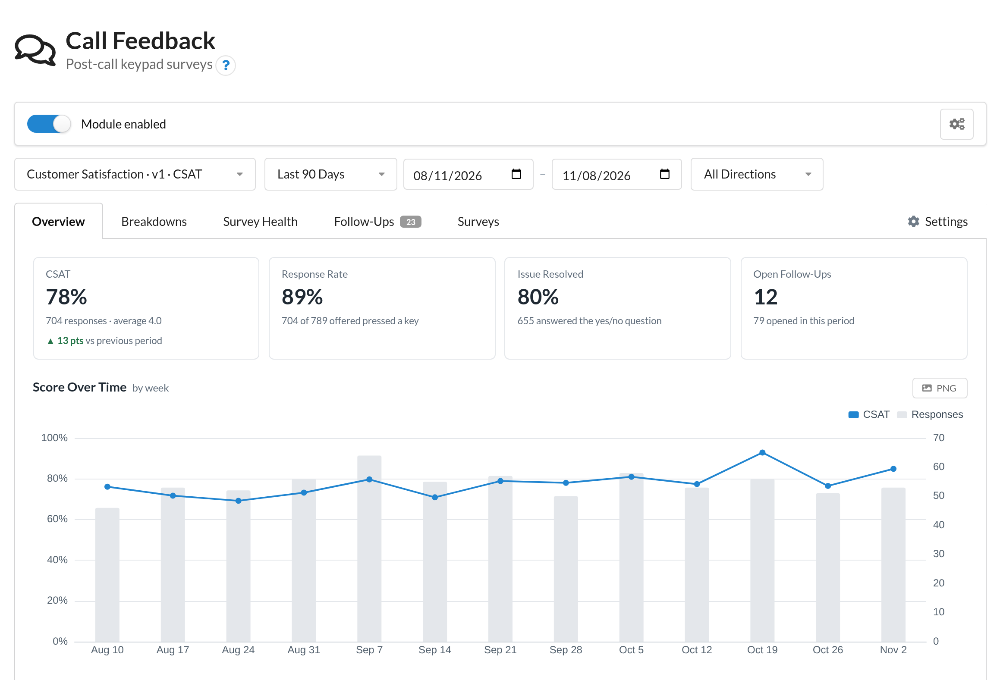
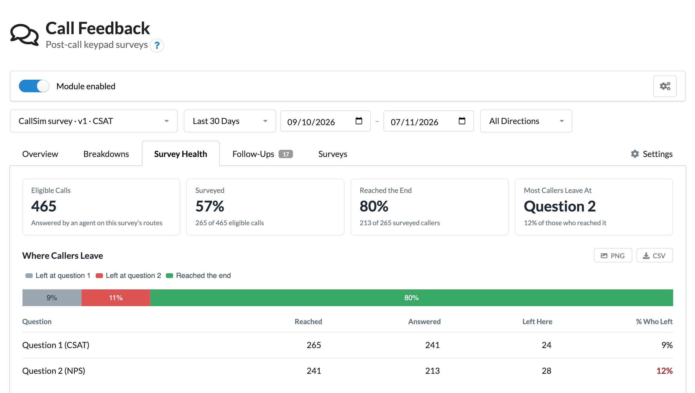
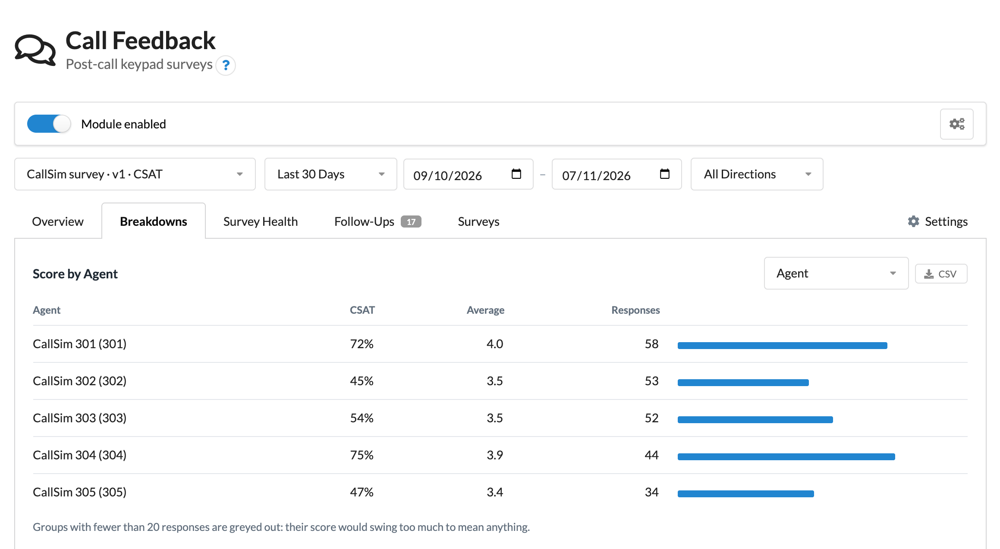
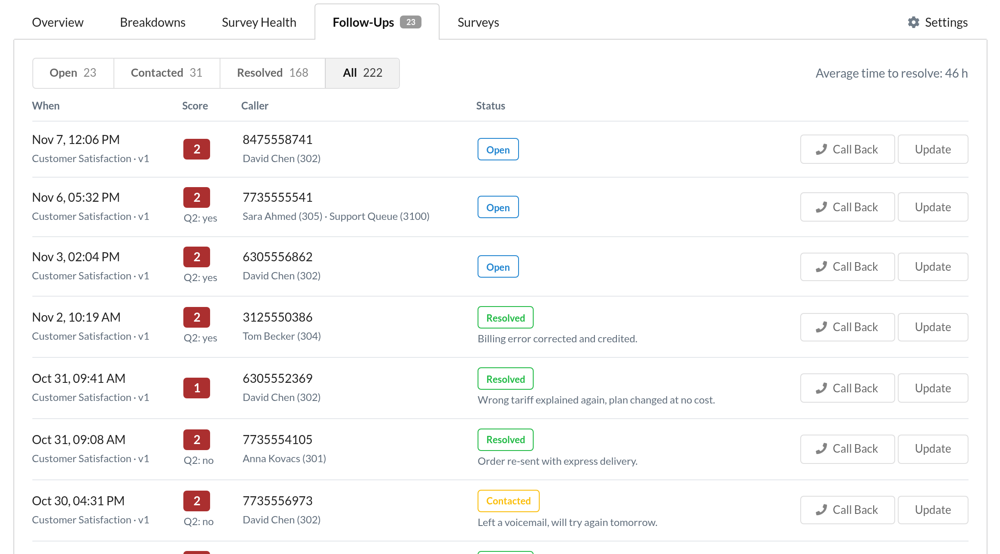
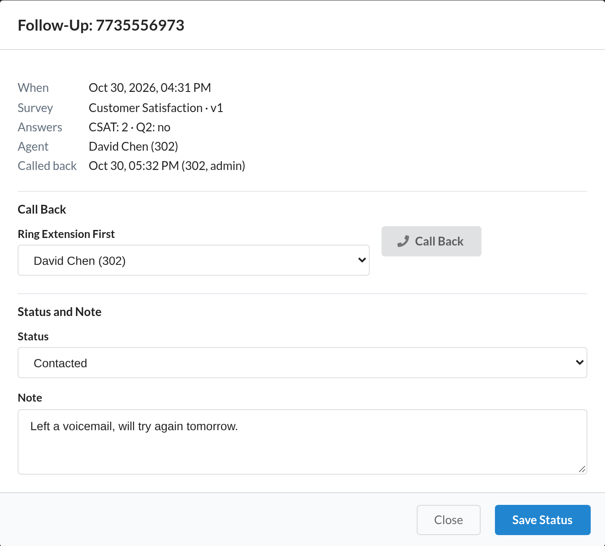
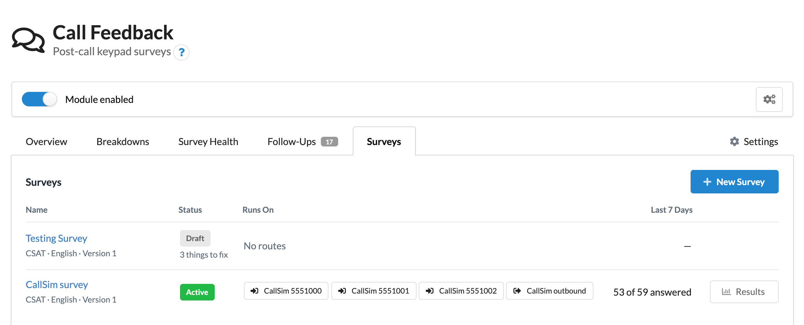
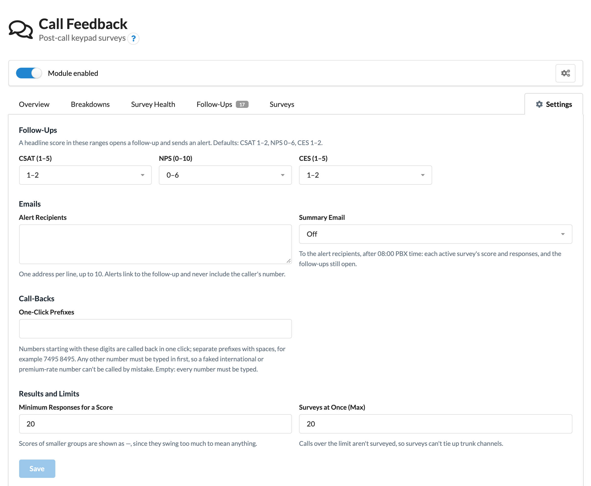
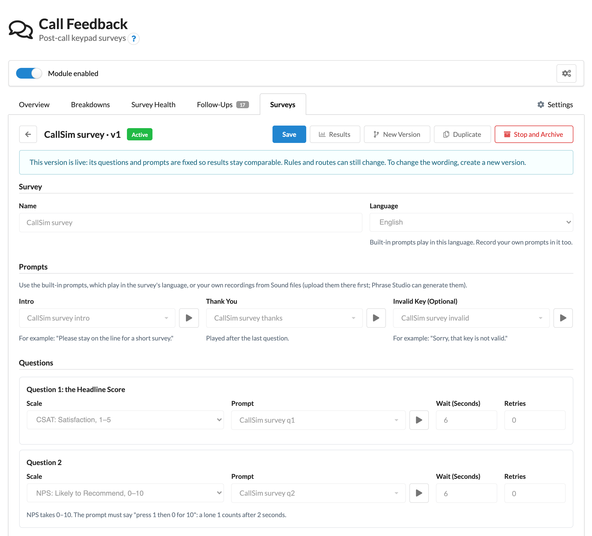

# Call Feedback for MikoPBX

**Module ID:** `ModuleCallFeedback`

A MikoPBX extension module that asks your callers how the call went. When the agent hangs up, the caller stays on the line for a short keypad survey: one headline score (CSAT 1–5, NPS 0–10 or CES 1–5) and up to two more questions, such as "was your issue resolved?". Every answer is tied to the call, its agent and its queue, and the admin cabinet shows the results, where callers drop out of the survey, and a follow-up list with email alerts for unhappy callers.

> **Status: in development, not released yet.** It works on MikoPBX 2026.6.34 and is tested with real calls, but it isn't ready for production use. Releases will be on the [Releases page](https://github.com/eneuen/ModuleCallFeedback/releases), and what changes in each version is in [CHANGELOG.md](CHANGELOG.md).

## Features

- **Surveys** on chosen incoming and outgoing routes: up to three questions on fixed scales (CSAT, NPS, CES, yes/no), built-in English and Russian prompts or your own recordings, and rules for minimum talk time, days and hours, the share of calls to survey and how often the same number is asked. A test call plays the survey to an extension before it goes live.
- **Results:** the headline score with its change from the previous period, response and resolution rates, the score over time, and the score by agent, queue, line, direction, hour, weekday, time to answer or talk time. Scores stay hidden until a group has enough responses.
- **Survey health:** how many eligible calls were surveyed, how many callers reached the end, the question where most of them leave, and how many calls each rule left out.
- **Follow-ups:** a low score opens a case with an email alert. Cases have a status and a note, and a call-back rings an agent's extension and then the customer, with safeguards against calling expensive numbers.
- **Versions:** once a survey is live its wording is fixed, so results stay comparable. Changing it means a new version, and versions are never averaged together.
- **Exports:** CSV of any results table, PNG of any chart, and an optional daily or weekly summary email.
- **Ready to try:** a new install starts with an example survey that uses the built-in prompts, so you can hear a survey on your own phone a minute after installing. New surveys can start from the same kind of template: CSAT, NPS or CES, each followed by "was your issue resolved?".
- **Languages:** English and Russian, following the admin cabinet's language. Each survey plays its prompts in English or Russian.

## Screenshots

The screenshots show a test PBX with simulated calls.

<table>
  <tr>
    <td width="50%" valign="top">
      
       <b>Survey Health.</b> How many eligible calls were surveyed, how far callers got, and the question most of them leave at.
    </td>
    <td width="50%" valign="top">
      
       <b>Breakdowns.</b> The score per agent, queue, line, direction, hour, weekday, time to answer or talk time.
    </td>
  </tr>
  <tr>
    <td width="50%" valign="top">
      
       <b>Follow-Ups.</b> Every call with a low score, filtered by status, ready to call back or update.
    </td>
    <td width="50%" valign="top">
      
       <b>A follow-up.</b> The call's answers, agent and queue; a call-back through your outgoing routes; and the case's status and note.
    </td>
  </tr>
  <tr>
    <td width="50%" valign="top">
      
       <b>Surveys.</b> Each survey with its status, the routes it runs on, and how many callers answered in the last 7 days.
    </td>
    <td width="50%" valign="top">
      
       <b>Settings.</b> The scores that open a follow-up, alert and summary emails, one-click call-back prefixes, and limits.
    </td>
  </tr>
  <tr>
    <td colspan="2" valign="top">
      
       <b>The survey editor.</b> Prompts and questions, then the rules, routes and a test call. A live version's wording is fixed; New Version starts a draft to change it.
    </td>
  </tr>
</table>

## Requirements

- MikoPBX 2026.6.34 or later.
- An admin account on the PBX: the module's pages are shown to admins only.
- Nothing to record to get started: the module ships prompts in English and Russian for the intro, CSAT, NPS, CES and "was your issue resolved?" questions, an invalid key and a thank-you. To use your own wording, upload recordings under **Sound files** (MIKO's Phrase Studio module can generate them) and choose them in the survey.
- For alert and summary emails: the PBX's mail settings, with email notifications switched on.

A survey can't be activated while:

- another module that surveys callers after the call is enabled, because both would survey the same calls;
- the PBX's default incoming action plays a sound file, because that replaces the step after the agent hangs up on every incoming route.

Incoming routes that match numbers by pattern can't be surveyed; routes for a single number or for any number can.

## Installing

1. Download `ModuleCallFeedback-<version>.zip` and its `.sha256` file from this repository's **Releases** page. Use that zip: the "Source code" downloads GitHub adds to each release are for developers and can't be installed.
2. Check the download against its checksum, for example with `shasum -a 256 -c ModuleCallFeedback-<version>.zip.sha256` (macOS or Linux).
3. In the MikoPBX admin cabinet, open **Modules**, upload the zip, then enable the module.

Call Feedback appears in the sidebar for admins. No call changes until you activate a survey.

**Try it:** open **Modules → Call Feedback → Surveys → Example Survey**, choose your extension under **Test call** and press **Place Test Call**. Your phone rings and plays the survey as a caller would hear it. The example is a draft with no routes, so it never reaches a real caller until you choose routes and activate it. It's in Russian when the PBX's prompt language is Russian.

**Updating:** upload the newer zip on the same page. Surveys, results, follow-ups and settings are kept.

**Uninstalling:** disable and delete the module on the same page. Its survey steps leave every call straight away, and its built-in prompts are removed from the PBX's sound folders. Unless you choose to keep its settings, its database (surveys, answers, follow-ups, settings) is deleted with it.

## Setting up a survey

Everything is under **Modules → Call Feedback**.

1. **Surveys → New Survey.** Choose what to start from: a template (CSAT, NPS or CES, each followed by "was your issue resolved?", with the built-in prompts already chosen) or a blank survey. Then give it a name and choose the prompt language. A survey from a template only needs routes and a test call; steps 2 and 3 are there to change it.
2. **Prompts and questions.** Choose the intro, thank-you and (optionally) invalid-key prompts, and up to three questions. Each prompt menu lists the built-in prompts first, which play in the survey's language, then your own sound files. Type to search the menu, and press the play button on any prompt in the list, or the one beside the menu, to hear it before you choose; that helps when sound files have unhelpful names. Question 1 is the headline score; the others can be any scale, including yes/no. For NPS, a prompt of your own must say "press 1 then 0 for 10", as the built-in one does.
3. **Who gets surveyed.** The minimum talk time (default 20 seconds), the days and hours the survey runs, the share of calls to survey, and how long to wait before asking the same number again (default 30 days).
4. **Runs on.** The incoming and outgoing routes the survey runs on. Only one active survey can run on a route.
5. **Test call.** Ring an extension and answer the survey as a caller would. A version needs a test call before it can go live.
6. **Activate.** The survey starts with the next call.

To change the questions or prompts of a live survey, create a new version: activating it replaces the old one, and each version's results are kept apart. Rules and routes can be changed on a live survey. A draft that was never activated can be deleted; a live survey is stopped by archiving it, which keeps its results.

**Settings** holds:

- the scores that open a follow-up (by default CSAT 1–2, NPS 0–6, CES 1–2);
- who gets alert emails, and an optional daily or weekly summary email;
- the number prefixes that can be called back in one click (none by default);
- how many responses a score needs before it's shown, and how many surveys can run at once;
- numbers never to survey, and "delete all data for a number".

## How it works

- **The caller stays on the line.** When the agent hangs up, an inbound caller (or, on outgoing routes, the customer) is moved into the survey instead of being disconnected. Every survey ends within 3 minutes, whatever is pressed.
- **Only answered calls are surveyed.** Calls that reached only an IVR, voicemail or a hangup action are skipped, and talk time is counted from the moment an agent answered, so time waiting in a queue doesn't count towards the minimum.
- **Your dialplan isn't edited.** The module adds its steps through MikoPBX's own module hooks, after any custom dialplan you have. With no active survey, it adds nothing to any call.
- **Answers are matched to the call.** A background worker stores each survey and, once the call is in the call history, fills in the agent, queue and real talk time. Only then does a low score open a follow-up and send an alert. Surveys under the minimum talk time are kept but left out of scores.
- **Nothing leaves the PBX.** The module makes no outside connections and adds no network ports or AMI users; the charts and their library are served from the PBX itself.

## Good to know

- **Not every caller can be asked.** Callers who hang up before the agent, and calls the agent blind-transfers, are never surveyed. Scores therefore lean towards callers who stayed on the line; the response rate and Survey health show how many were reached.
- **Routes belong to the survey, not to a version.** Changing the routes on a new draft also changes them for the live version as soon as you save.
- **Results are per version.** Different wordings are never averaged together; pick the version in the results toolbar.
- **"Don't ask again" covers every survey.** A number one survey has asked isn't asked by another survey either until that survey's own waiting time has passed, so nobody is surveyed twice in a row.
- **Callers answer with their keypad, as in an IVR menu.** If keys work in your IVR menus, they work in the survey: the survey reads them the same way.
- **Calls a rule skips are counted.** Calls left out because they were too short, outside the survey's hours, excluded, asked recently, not sampled or over the limit of surveys at once appear under Survey health.

## Tested limits

Benchmarked for a busy small office: 200 surveyed calls a day for a year, on 2 CPUs, within the admin cabinet's 128 MB PHP memory limit. The Overview of a whole year takes about 0.16 s, every other page less, and PHP needs at most 10 MB. At 1,000 a day, a year's Overview takes under a second. Details and method: [tools/benchmark](tools/benchmark/README.md).

## Privacy and data

- Callers' numbers follow the PBX's own retention period, the **Call recording storage period** on the **Storage** page, which also sets how long MikoPBX keeps its call history. After that, numbers are removed from survey results; scores, agents and queues stay. The "don't ask this number again" memory follows the same limit.
- **Delete all data for a number** (Settings) removes a caller's answers and follow-ups at once, for example when a caller asks.
- Alert and summary emails carry the survey, score, agent and a link to the page, never the caller's number.
- No audio is recorded. Answers are keypad presses only.
- Everything the module stores is in its own database on the PBX, deleted when you uninstall it without keeping settings.

## Security

- **Admins only.** Every request is checked for the `admins` role by the module itself, on top of MikoPBX's own checks, and changes need the signed-in admin's token, so another website can't make them.
- **Callers can't steer the PBX.** Nothing typed by an admin or pressed by a caller is written into the dialplan, and the survey steps can't be dialled from a phone or a trunk.
- **Call-backs can't be turned against you.** A caller can fake an international or premium-rate number and wait to be called back. Only numbers that start with a prefix you list in Settings are called back in one click; any other number has to be typed in to match. Call-backs go through your outgoing routes and their restrictions, and each one is logged with who placed it.

See [SECURITY.md](SECURITY.md) for how to report a vulnerability.

The checks run before a release (access by every kind of user, hostile caller IDs, tampered requests, reaching the survey from a phone or trunk, holding the line, many surveys at once, and a clean uninstall) and their results are listed in [CHANGELOG.md](CHANGELOG.md).

## Contributing

Bug reports, ideas and pull requests are welcome. [CONTRIBUTING.md](CONTRIBUTING.md) explains how to run the tests and checks, how a survey runs under the hood, how the code is laid out, and how releases are made. Before a release, the survey is checked with real SIP calls against MikoPBX, using the test harness in [tools/callsim](tools/callsim/README.md).

## License

GPL-3.0-or-later. See [LICENSE](LICENSE). The built-in prompts in `Sounds/` are dedicated to the public domain under CC0 1.0 (see [Sounds/LICENSE](Sounds/LICENSE)), so you can reuse them anywhere. The bundled Apache ECharts is Apache-2.0; its licence and notice are in `public/assets/js/vendor/`.

Net Promoter, NPS and Net Promoter Score are registered trademarks of Bain & Company, Inc., Satmetrix Systems, Inc. and Fred Reichheld.
